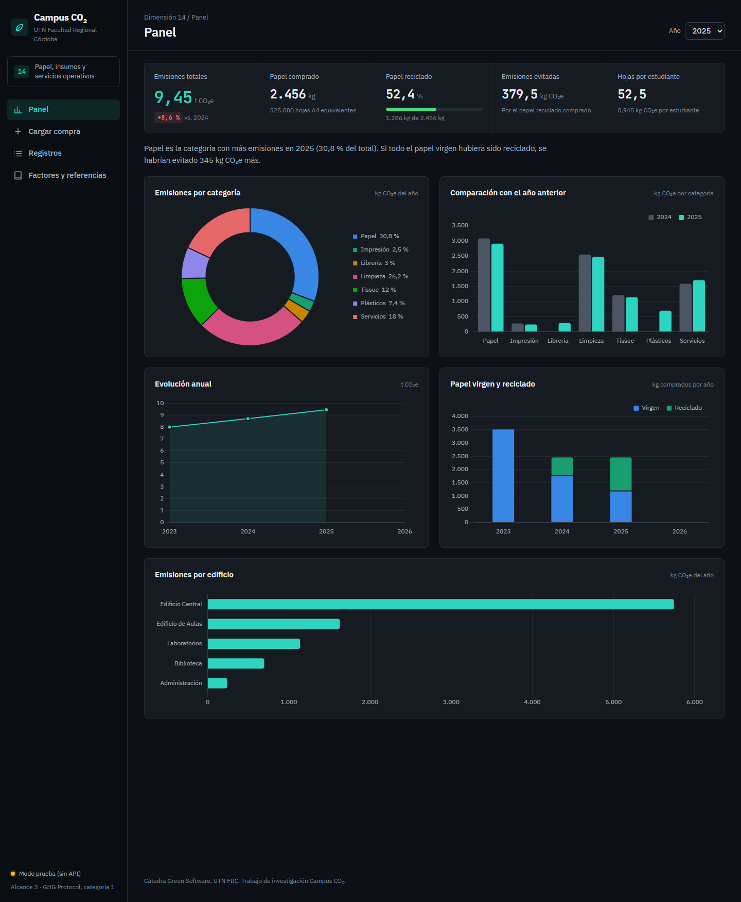

# TPI 2 – Green Software · Campus CO₂

**Dimensión:** 14 — Papel, insumos y servicios operativos
**Institución:** UTN – Facultad Regional Córdoba
**Alcance:** 3 (Cat. 1 GHG Protocol: bienes y servicios adquiridos) + emisiones evitadas
**Periodicidad:** anual

Módulo frontend (HTML/CSS/JavaScript) de carga, cálculo y visualización de la huella de carbono de papel e insumos. Consume la API central de la cátedra; **no implementa una API propia**.



## Cómo ejecutarlo

Requiere Node.js 18 o superior (no hace falta `npm install`, no hay dependencias):

```bash
npm run dev   # desarrollo: recarga el navegador al guardar cambios
npm start     # solo sirve la página
npm test      # pruebas automáticas del cálculo
```

y abrir http://localhost:5500. Para usar otro puerto: `npm run dev -- --port=5501`.
`server.js` solo sirve los archivos estáticos de `frontend/`; **no es una API**.

Por ahora funciona en **modo prueba** (`USE_MOCK: true` en `frontend/js/config.js`): los registros se guardan en el navegador. Para ver la app con datos de ejemplo: http://localhost:5500/?demo=1

Cuando la cátedra publique la API: cambiar `API_BASE_URL`, `USE_MOCK: false` y ajustar `ENDPOINTS` en `config.js` (ver `docs/05-integracion-api.md`).

## Qué hace

| Sección | Funciones |
|---|---|
| **Panel** | Emisiones totales y variación anual, papel comprado, % reciclado, emisiones evitadas, hojas y kg CO₂e por estudiante. Gráficos por categoría, comparación con el año anterior, evolución, papel virgen vs reciclado y por edificio. |
| **Cargar compra** | Formulario con validaciones, cálculo en vivo paso a paso, unidades (resma, hoja, kg, g, t, litro, unidad, ARS, USD), estimador de papel de exámenes, edición de registros. |
| **Registros** | Tabla con la trazabilidad de cada cálculo, filtros, total, importar la planilla del relevamiento (CSV), exportar CSV. |
| **Factores y referencias** | Factores de emisión con su fuente y si están verificados; matrícula por año. |

## Estructura

```
docs/
  01-modelo-medicion.md   Qué se mide, variables, fórmulas, factores verificados, alcance
  02-modelo-datos.md      DER (Mermaid) y diccionario de datos
  03-relevamiento.md      Qué datos pedir, a quién, nota modelo, plantilla, limitaciones
  04-arquitectura.md      Módulos, flujo de un registro, trazabilidad
  05-integracion-api.md   Estado de la API de la cátedra y contrato supuesto
  08-uso-ia.md            Uso de IA y cómo se validó
  09-guion-video.md       Guion para el video de presentación
  capturas/               Capturas de cada sección
frontend/
  index.html
  css/styles.css
  js/
    config.js             URL de la API, endpoints, constantes
    mock-data.js          Datos de prueba (edificios, insumos, factores)
    api.js                Integración con la API central (o modo prueba)
    calculo.js            Conversión de unidades, factor de emisión, trazabilidad
    app.js                Estado, navegación, procesamiento de registros
    carga.js              Formulario, validaciones, edición, cálculo en vivo
    registros.js          Tabla, importación y exportación CSV
    factores.js           Factores de emisión y datos de referencia
    visualizacion.js      Indicadores y gráficos (Chart.js)
tests/
  calculo.test.js         12 pruebas del cálculo (npm test)
server.js                 Servidor estático de desarrollo (no es una API)
```

## Checklist de los 8 componentes

- [x] 1. Modelo de medición → `docs/01-modelo-medicion.md` (factores DESNZ 2024 verificados; 4 supuestos documentados)
- [x] 2. Modelo de datos → `docs/02-modelo-datos.md` (ajustar a la API real cuando se publique)
- [ ] 3. Relevamiento → `docs/03-relevamiento.md` (nota modelo y plantilla listas; **faltan los datos reales**)
- [x] 4. Módulo de carga (formulario, validaciones, edición, importación CSV)
- [ ] 5. Integración con API central (capa lista en `api.js`; **la cátedra todavía no publicó la API**)
- [x] 6. Módulo de cálculo (conversión, factor, trazabilidad, tests)
- [x] 7. Módulo de visualización (indicadores y 5 gráficos)
- [x] 8. Documentación (arquitectura, API, capturas, uso de IA, guion del video). **Falta agregar los resultados del relevamiento.**
