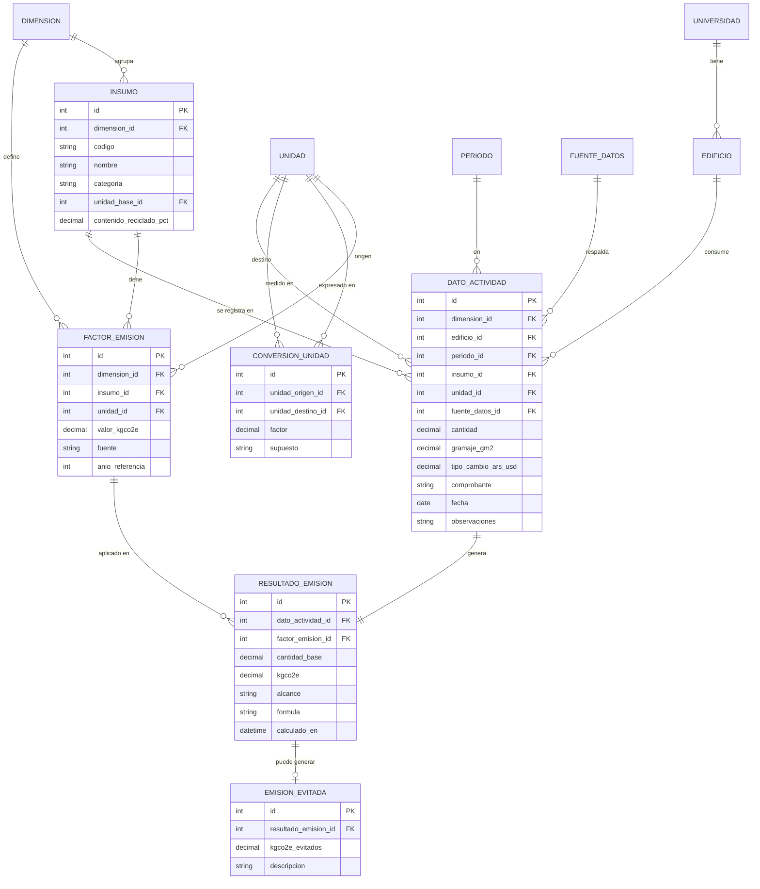

# 2. Modelo de datos

El módulo **no tiene base de datos propia**: usa las entidades centrales de la cátedra (`universidades`, `edificios`, `periodos`, `dimensiones`, `unidades`, `fuentes_datos`, `factores_emision`, `datos_actividad`, `resultados_emisiones`, `emisiones_evitadas`) y propone **dos entidades específicas** de la dimensión: `insumo` y `conversion_unidad`.

## 2.1 Diagrama entidad-relación

## 2.2 Diccionario de datos

### `insumo` (entidad propia de la dimensión)

| Atributo | Tipo | Nulo | Descripción |
|---|---|---|---|
| id | int | No | Identificador |
| dimension_id | int (FK) | No | Siempre la dimensión 14 |
| codigo | varchar(30) | No | Código interno, ej. `PAPEL_VIRGEN` |
| nombre | varchar(100) | No | Nombre legible |
| categoria | varchar(40) | No | `papel`, `carton`, `impresion`, `libreria`, `limpieza`, `tissue`, `plastico`, `servicios` |
| unidad_base_id | int (FK) | No | Unidad en la que está expresado el factor (kg, unidad, USD) |
| contenido_reciclado_pct | decimal(5,2) | Sí | 0–100 |

### `conversion_unidad` (entidad propia)

| Atributo | Tipo | Nulo | Descripción |
|---|---|---|---|
| id | int | No | Identificador |
| unidad_origen_id | int (FK) | No | Ej. resma |
| unidad_destino_id | int (FK) | No | Ej. kg |
| factor | decimal(12,6) | No | Multiplicador origen → destino |
| supuesto | varchar(200) | Sí | Ej. "A4, 500 hojas, 75 g/m²" |

### `dato_actividad` (central; campos que usa la dimensión)

| Atributo | Tipo | Nulo | Descripción |
|---|---|---|---|
| id | int | No | Identificador |
| dimension_id | int (FK) | No | 14 |
| edificio_id | int (FK) | No | Edificio que recibió el insumo |
| periodo_id | int (FK) | No | Año |
| insumo_id | int (FK) | No | Qué se compró |
| unidad_id | int (FK) | No | Unidad en la que se cargó |
| fuente_datos_id | int (FK) | No | Factura, orden de compra, estimación… |
| cantidad | decimal(14,4) | No | > 0 |
| gramaje_gm2 | decimal(6,2) | Sí | Solo papel; por defecto 75 |
| tipo_cambio_ars_usd | decimal(12,4) | Sí | Solo montos cargados en pesos; convierte ARS a USD para el factor de servicios |
| comprobante | varchar(50) | Sí | N.º de factura / OC |
| fecha | date | No | Fecha del comprobante |
| observaciones | text | Sí | — |

### `resultado_emision` (central)

| Atributo | Tipo | Nulo | Descripción |
|---|---|---|---|
| id | int | No | Identificador |
| dato_actividad_id | int (FK) | No | Registro que lo originó |
| factor_emision_id | int (FK) | No | Factor aplicado (trazabilidad) |
| cantidad_base | decimal(14,4) | No | Cantidad convertida a la unidad del factor |
| kgco2e | decimal(14,4) | No | Resultado |
| alcance | varchar(10) | No | `3` |
| formula | text | No | Texto con el cálculo paso a paso |
| calculado_en | datetime | No | Marca de tiempo |

### `emision_evitada` (central)

| Atributo | Tipo | Nulo | Descripción |
|---|---|---|---|
| id | int | No | Identificador |
| resultado_emision_id | int (FK) | No | Resultado asociado (papel reciclado) |
| kgco2e_evitados | decimal(14,4) | No | `kg × (FE_virgen − FE_reciclado)` |
| descripcion | varchar(200) | Sí | — |

> Los nombres exactos de las tablas y campos centrales se ajustarán cuando la cátedra publique la API (ver `frontend/js/config.js`).
