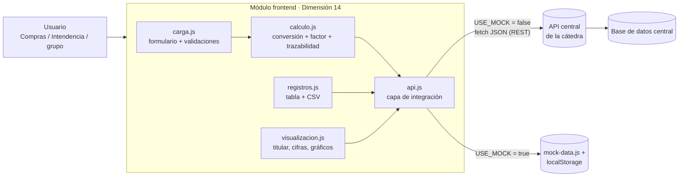

# 4. Arquitectura

## 4.1 Vista general



- **No hay backend propio.** El frontend es HTML + CSS + JavaScript sin frameworks ni compilación.
- `server.js` solo sirve los archivos estáticos para desarrollo (y recarga el navegador con `npm run dev`). **No es una API.**
- Toda comunicación con datos pasa por `api.js`. El resto del código no sabe si está hablando con la API real o con el modo prueba.

## 4.2 Módulos

| Archivo | Responsabilidad | Componente del TP |
|---|---|---|
| `config.js` | URL de la API, endpoints, constantes (gramaje, densidad, áreas de hoja) | 5 |
| `mock-data.js` | Catálogos y factores provisorios para trabajar sin la API | 5 |
| `api.js` | `GET` de catálogos y registros, `POST` de dato de actividad, resultado y emisión evitada | 5 |
| `calculo.js` | Conversión de unidades, aplicación del factor, emisiones evitadas, estimador de exámenes | 6 |
| `app.js` | Estado compartido, navegación entre secciones (`#panel`, `#carga`, `#registros`, `#factores`), avisos, `procesarRegistro()`, modo demo (`?demo=1`) | — |
| `carga.js` | Formulario, validaciones, edición de registros, cálculo en vivo | 4 |
| `registros.js` | Tabla con trazabilidad, filtros, total, importación y exportación CSV | 3, 6, 7 |
| `factores.js` | Factores de emisión con fuente y estado; matrícula por año | 1, 6 |
| `visualizacion.js` | Indicadores clave y 5 gráficos (Chart.js) | 7 |
| `tests/calculo.test.js` | 12 pruebas automáticas del cálculo (`npm test`) | 6 |

## 4.3 Flujo de un registro

1. El usuario completa el formulario. En cada cambio, `procesarRegistro()` recalcula y el comprobante de cálculo muestra cada paso.
2. Al guardar, `validar()` revisa: cantidad > 0, unidad válida para el insumo, gramaje 40–300 g/m², fecha dentro del año elegido, comprobante obligatorio si la calidad es A.
3. `api.guardarRegistro()` envía, en orden:
   1. `POST /datos-actividad` → devuelve el `id` del dato.
   2. `POST /resultados-emisiones` con `dato_actividad_id`, `factor_emision_id`, `cantidad_base`, `kgco2e`, `alcance` y `formula`.
   3. Si es papel reciclado: `POST /emisiones-evitadas`.
4. Se recargan los registros y se actualizan tabla e indicadores.

## 4.4 Trazabilidad

Cada resultado guarda el **id del factor aplicado** y la **fórmula en texto**, por ejemplo:

```
120 resma × 2,3389 kg/resma (A4, 500 hojas, 75 g/m²) = 280,665 kg
280,665 kg × 1,0443 kg CO₂e/kg = 293,104 kg CO₂e
Factor #102: DESNZ 2024 — Paper, closed-loop source (1044,32 kg CO₂e/t) (2024)
```

Así cualquier número de los indicadores se puede reconstruir a mano desde la tabla de registros o desde el CSV exportado.

## 4.5 Decisiones de diseño

- **JavaScript sin módulos ES** (scripts clásicos con un espacio de nombres `CO2`): la página también funciona abriendo `index.html` con doble clic, sin servidor.
- **Chart.js 4.4.1 desde CDN**: si no hay internet, los indicadores numéricos se ven igual y los gráficos muestran un aviso.
- **Interfaz oscura tipo consola de monitoreo**: menú lateral (en celular pasa a una barra superior), tipografías IBM Plex Sans y JetBrains Mono (cifras).
- **Paleta de gráficos validada** sobre fondo oscuro para daltonismo (protanopía, deuteranopía, tritanopía) y contraste ≥ 3:1. Cada categoría tiene siempre el mismo color, y el porcentaje figura en la leyenda para no depender solo del color.
- **Accesibilidad**: navegación por teclado, foco visible, enlace "Ir al contenido", avisos con `aria-live`, respeta "reducir movimiento" del sistema. Probado a 375 px de ancho sin scroll horizontal.
